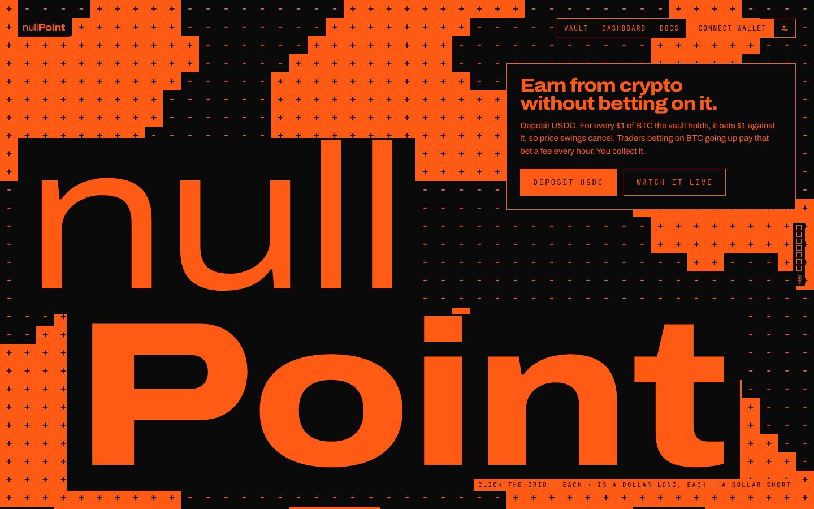
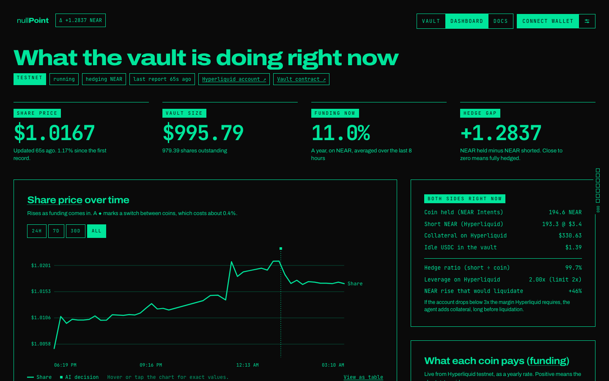
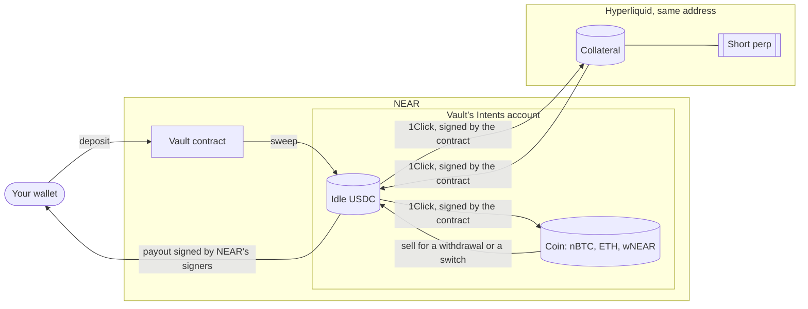
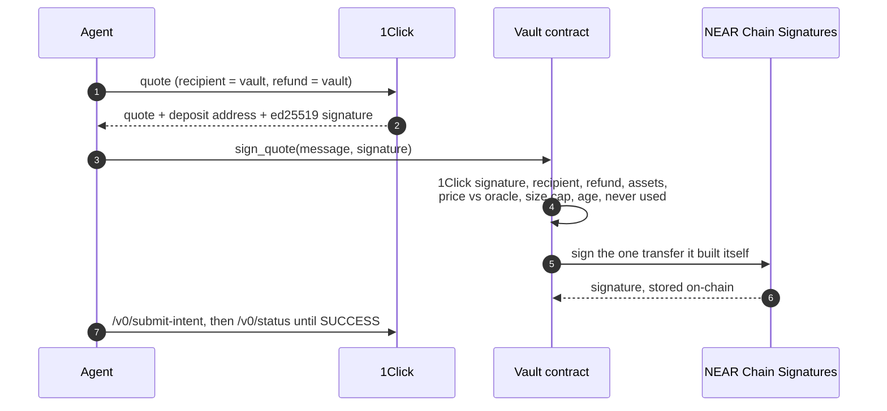

# NullPoint

**Deposit USDC on NEAR and earn the funding that Hyperliquid traders pay, without betting on price and without handing the money to the bot that runs it.**

NullPoint is a vault. It holds a coin (BTC, ETH or NEAR) in NEAR Intents and an equal short of that coin on Hyperliquid. When the price moves, one side gains what the other loses. What's left is funding: the fee that traders betting on prices going up pay, every hour, to the people betting against them.

How it works in one line: a NEAR contract owns the vault's Intents account and its Hyperliquid account through **Chain Signatures**; an **agent** brings signed **1Click** quotes that the contract checks before NEAR's signers sign anything; an **AI on NEAR AI Cloud** picks the coin inside limits it can't change; and the agent's own keys can trade but can't withdraw. It runs on NEAR mainnet with real USDC (capped at $100 while unaudited) and on testnet with free test USDC.

<p align="center"></p>

**▶ Demo video (1:48):** [the X post](https://x.com/demigohu/status/2121173944632037500), from a deposit to the agent's work, a paid withdrawal, the attack script refused and mainnet.

Built for **NEAR HACKATHON** (November 2026), tracks **Unstoppable DeFi**, **AI Security & Defense** and **Agent Economy**. Independent project; not affiliated with NEAR, Hyperliquid or 1Click.

| | |
|---|---|
| App | https://nullpoint.fun |
| Docs (23 pages, 14 diagrams, live checks) | https://docs.nullpoint.fun |
| Status | https://status.nullpoint.fun |
| Demo video | https://x.com/demigohu/status/2121173944632037500 |
| Mainnet vault, source verified | [`vault.nullpoint.near`](https://nearblocks.io/address/vault.nullpoint.near) |
| Testnet vault, source verified | [`vault.nullpoint.testnet`](https://testnet.nearblocks.io/address/vault.nullpoint.testnet) |

## Run it in 3 commands (no wallet, no keys, no money)

```sh
git clone https://github.com/demigohu/nullpoint && cd nullpoint
npm install
npm run demo        # Node 24+, about a minute
```

The demo reads the live vaults and checks the main claims. Real output from 12 Nov 2026 (UTC), trimmed a little, from a run where 1Click was timing out so the demo fell back to a recorded quote:

```text
1. Live vault on NEAR testnet
   NAV 995.98 USDC (posted 48s ago), 979.39 shares, paused: false
   short on Hyperliquid: -193.3 NEAR; account 330.550822 USDC

2. One EVM address, controlled by the vault contract through NEAR Chain Signatures
   recomputed from the MPC root key: 0x55c7c56049847f23540209b7dbd401bf242b5908
   configured in the contract:       0x55c7c56049847f23540209b7dbd401bf242b5908 ✅
   Hyperliquid agents approved by that address (signed by MPC): nullpoint-keeper 0x5788b8619093e8f3a8dec1ebe479989b627d9023

3. A real 1Click quote (mainnet), verified like vault.sign_quote verifies it
   1Click didn't answer (…timeout…), using a recorded one
   recorded real quote from contracts/vault/testdata, recipient 0x5e33437e5b871f1aa9e252dd00a36c53dfcb9a8d
   ed25519 signature by 1Click's manager key: ✅
   same quote with the recipient swapped to an attacker: ✅ rejected

4. The live position, with the price moved ±20%: spot and short cancel
   194.58365925456982 NEAR held, -193.3 NEAR short, mark $3.422
   -20%: spot -$133.17, short +$132.29 -> NAV $996.04 -> $995.16
   +20%: spot +$133.17, short -$132.29 -> NAV $996.04 -> $996.92

5. A compromised strategist asks for the attacker's wish list
   ✅ blocked ROTATE SOL       -> target SOL not allowlisted
   ✅ blocked SET_LEVERAGE 20  -> leverage 20 outside 1-2
   ✅ blocked WITHDRAW 0xdead  -> unknown action WITHDRAW
```

**What to look for:**
- Step 2: the ✅ means the address that owns the money on Hyperliquid and in NEAR Intents is derived from the contract account itself. No person holds that key.
- Step 3: change one field of a signed 1Click quote and the contract's check fails. That's what stops the agent from routing a swap to itself.
- Step 4: a 20% move shifts the vault by under $1, the small part of the coin that isn't hedged yet.
- Step 5: the AI's answers pass through fixed limits; "withdraw" isn't even an action it can express.

## Every command, and what you should see

The first four need nothing: no wallet, no keys, no `.env`. `npm run demo` and `npm test` were checked on a fresh clone with no `.env` on 12 Nov.

| Do | Needs | You should see |
|---|---|---|
| `npm run demo` | Node 24+ | The five checks above, with ✅ on the address match, the 1Click signature, the forged quote and the three blocked AI requests |
| `npm test` | Node 24+, Rust, `cargo-near` | Every suite passes: core tests (MPC address derivation, strategy limits), the field test, **25** contract unit tests and **2** sandbox integration tests (`test result: ok`). The sandbox tests take about 80 s the first time |
| `npm run simulate:crash` | Node 24+ | BTC −20% and +20% over 24 h, hour by hour: spot and short PnL cancel, NAV goes from $1000.00 to $1000.16 (down move) and $1000.20 (up move), the difference being funding |
| `npm run simulate:strategy` | Node 24+ | Three weeks of real Hyperliquid mainnet funding: holding BTC vs the vault's rule, as a yearly rate after the 0.4% switching cost (12 Nov: both 10.09%, no switch worth making). Add `--llm` with a NEAR AI key to include the AI |
| `npm run dev` | Node 24+ | Web on http://localhost:3000 and docs on http://localhost:3001, reading the live vaults |
| `npm run attack` | testnet agent keys in `.keys/` | The agent's own keys try four thefts: Hyperliquid `withdraw3`, `usdSend` and `agentSendAsset` to an outside wallet, and a 1Click quote paying an attacker. Four `✅ … rejected` lines, and the vault's Hyperliquid balance unchanged |
| `npm run attack:llm` | `NEARAI_API_KEY` | 1: the real model reads hostile "market notes" and its answer still passes the limits (TEE-signed: true). 2: a fully compromised model's SOL, 20x and withdraw requests, each `✅ blocked` with the reason |
| `npm run e2e:testnet` | testnet owner and user keys | Deposit → shares minted → sweep into the Intents stand-in → report sets the NAV → withdrawal signed by NEAR's MPC network and submitted from the user's own account → `E2E OK` |
| `npm run agent` | `.env` with agent keys | One line per run: prices, decisions (`llm -> HOLD … ACCEPTED`), moves (`shorted BTC …`, `bought BTC with … USDC`) and `NAV … paused false` |

## What works, and where it's verified

All times UTC.

| Feature | What happens | Verified |
|---|---|---|
| **The contract owns the accounts** | `vault.nullpoint.near` derives `0x610d…b939` through `v1.signer`. That address holds the coin in `intents.near` and the short on Hyperliquid | **Mainnet**, 12 Nov: NEAR's signers signed `approveAgent` for the trading key at the contract's request ([`BWsqw7Cc…`](https://nearblocks.io/txns/BWsqw7CcbZ54rQpRhtAxXY85kYuf6NMsQQu3QP7BqsaX)). `npm run demo` recomputes the address on testnet |
| **Deposit** | `ft_transfer_call` to the vault mints shares in the same transaction, minus a 0.5% fee | **Mainnet**, 12 Nov: 44 USDC deposited and swept into the vault's Intents account ([`G5cmNQxc…`](https://nearblocks.io/txns/G5cmNQxcqLA2sYy4L5xQGV8VjgqxpThbz31TxGfzWjEb)) |
| **Verify-then-sign swaps** | The agent brings a 1Click quote; the contract checks 1Click's signature, recipient, price, size and age, builds the transfer, asks NEAR's signers to sign; the agent submits it to `/v0/submit-intent` | **Mainnet**, 12 Nov: 14.77 USDC of collateral to Hyperliquid, 14.45 arrived ([`G9ManbtA…`](https://nearblocks.io/txns/G9ManbtAdVcFvedKdRg4VAbcXueZg9TRfZPFpwDKSwD4)); 29.32 USDC of BTC bought ([`6Q4Yuh5N…`](https://nearblocks.io/txns/6Q4Yuh5NCyGcyGjgPngXxPTUk7cPqUVuiAWDuWygTork)). Both 1Click `SUCCESS`. Contract tests reject forged, redirected and replayed quotes |
| **Short first** | Every swap adjusts the short before the coin changes; if Hyperliquid refuses the order, the swap doesn't happen | **Mainnet**, 12 Nov: short 0.0004 BTC at 17:49:07, BTC bought at 17:49:33. Hedged result: 0.00040764 nBTC against 0.0004 BTC short |
| **The contract prices the vault** | Balances read from `intents.near`, priced with signed 1Click quotes; the agent's Hyperliquid report must land within 2% of what the contract expects or the vault pauses | **Testnet**, 12 Nov: a report the contract couldn't explain paused the vault until the cause was fixed (see [Lessons](apps/docs/content/docs/lessons.mdx)). Contract tests `hedge_and_account_value_checks`, `account_value_is_checked_against_the_last_report` |
| **Withdraw** | `request_withdraw` → the agent frees USDC → `fulfill_withdraw` (NEAR's signers sign the payout) → `execute_withdraw` | **Mainnet**, 12 Nov: 5 shares → 4.81 USDC ([`8ViwcjoZ…`](https://nearblocks.io/txns/8ViwcjoZWNkZmdWRsywVop1GjxAvRftwP4p8UBdcW3rj)). **Testnet**: 500 shares → 504.00 USDC after the agent sold BTC twice and pulled collateral ([`3rfBhyzf…`](https://testnet.nearblocks.io/txns/3rfBhyzfAbXBLVmGGp8F6zKRwBLftbTJY81WyypvAE3Y)) |
| **Withdraw without the agent** | `execute_withdraw` has no caller check; a signed payout can only pay the person who asked | **Testnet**, 11 Nov: payout submitted from the user's own account ([`ALJ1g82Q…`](https://testnet.nearblocks.io/txns/ALJ1g82Qeg4VgBjt9r4pvhnWgmunWoKoo874rXQWJAYX)). `npm run e2e:testnet` |
| **Switching coins** | When another coin's funding pays back the ~0.4% cost within a week, the vault moves in capped steps, short first | **Testnet**, 12 Nov: BTC → NEAR in six runs over about 15 minutes, costing 0.45% of the vault ([`3ArGZtZr…`](https://testnet.nearblocks.io/txns/3ArGZtZr6VYXSZmbGJyEcrqdWwmp4dGgEWaD8jT7bLL3), first step) |
| **AI decisions on the record** | Each decision is stored on-chain with the model's chat id and the enclave's signing address, accepted or not | **Testnet**, 12 Nov: staging that switch, the AI refused to move into NEAR because its open interest was only about $168k; the fixed rule switched. Both are in `get_decisions` |
| **The agent can't steal** | Its NEAR key can only call the vault; its Hyperliquid key can only trade | `npm run attack`: `withdraw3`, `usdSend`, `agentSendAsset` and a quote paying an attacker are all refused |
| **Crash recovery** | Every fund move is journaled and finished after a restart | **Testnet**, 12 Nov: `resumed move to 42b26344ce…` on the first run after a restart |
| **Monitoring** | `/api/health` checks both vaults (paused, reporting, hedge, agent gas, key expiry) and answers 503 when something is wrong; Uptime Kuma alerts the owner | https://status.nullpoint.fun |
| **Verified source** | Reproducible builds (NEP-330, Docker) | NearBlocks shows both vault contracts as verified |

The full mainnet transaction list, step by step: [docs → Mainnet proof](apps/docs/content/docs/mainnet.mdx).

<p align="center"></p>

## Judge path

**A. No wallet (5 minutes).** Run `npm run demo` and `npm test` → you see the results in the table above. Then open https://docs.nullpoint.fun/verify → six claims about who can move the money, each marked "checked live: true" against both vaults, each with the command to repeat it.

**B. Testnet, with a NEAR testnet wallet (10 minutes).**
1. Open https://nullpoint.fun, connect a testnet wallet, and choose **Get 100 test USDC** in the account menu (top right) → your balance shows 100.00 USDC.
2. **Vault → Deposit**, enter 50, **Review deposit** → the dialog shows the shares you'll get, the 0.5% fee and that the vault's cap allows it, before your wallet opens. Sign → your shares and value appear at once, with the deposit fee shown separately.
3. **Dashboard** → within a minute or two the activity log shows "Collateral sent to Hyperliquid", "Opened the … short" and "Bought …", each with its transaction and the payload NEAR's signers signed; the hedge gap returns to about zero.
4. **Vault → Withdraw**, enter some shares, **Review withdrawal**, sign → the withdrawal shows requested → signed → paid, with links to both transactions, and the USDC is back in your wallet in 1-3 minutes.

**C. Mainnet, read only.** Switch the account menu to mainnet → the dashboard shows the real position (coin in NEAR Intents, short on Hyperliquid, both linked). https://docs.nullpoint.fun/mainnet → the live position and every transaction of the first day. Depositing works but isn't needed; the cap is $100.

**D. Try to break it.** `npm run attack` and `npm run attack:llm` (see the table for what they need and print). Without keys: `cd contracts && cargo test -p vault` → forged, redirected and replayed quotes and bad reports are all refused.

## How the money moves



About two thirds of the vault holds the coin and one third is collateral, so the short is the same size as the coin at 2x leverage on Hyperliquid.

Every arrow out of the vault's accounts is a payload the contract built and NEAR's MPC network signed:



A stolen agent key could at worst pick the worst quote that still passes the price check (1.5% per swap), or trade the short badly. It can't send the money anywhere but a 1Click deposit address tied to a quote that pays the vault.

## What the AI decides, and what is plain code

| AI (NEAR AI Cloud, in a TEE) | Plain code |
|---|---|
| Every 30 minutes, whether to hold, switch coin, park in USDC, come back, or change leverage. It answers in a closed JSON schema with no address or amount fields | Everything that touches money: which quote, how much, where, when to pay a withdrawal |
| Model: `deepseek-ai/DeepSeek-V4.1-Flash-1017`. Its answer is signed in the enclave and checked against the enclave's attestation before use | The limits (`packages/core/src/strategy.ts`): BTC/ETH/NEAR only, 1-2x, two switches per 24 h, six-hour hold, one-week payback on measured funding, confidence ≥ 0.6 |
| Sees live funding, open interest, what the vault holds, and the payback of each switch, computed for it | A fixed rule makes the same kind of decision when the model is down or its answer fails the signature check |
| | The contract: verifying quotes, building every payload, pricing the vault, checking reports, pausing |

## What the contract signs, and nothing else

| Payload | Standard | Built from |
|---|---|---|
| Intents transfer | ERC-191, for `intents.near` | A verified 1Click quote: one transfer of the quoted amount to the quoted deposit address |
| Intents withdrawal | ERC-191 | A queued withdrawal: USDC to the account that asked |
| Hyperliquid `sendAsset` | EIP-712 | A verified 1Click quote back to the vault |
| Hyperliquid `approveAgent` | EIP-712 | The owner's request, by address and name |

## What running it on mainnet taught us

- **Hyperliquid charges 1 USDC to send to an address it hasn't seen**, and 1Click uses a fresh deposit address per quote. Testnet never showed it. Fix: a larger dust allowance on mainnet, and collateral comes back only in 20 USDC steps; small withdrawals sell coin instead.
- **Hyperliquid won't approve a trading key for an empty account.** Bootstrap order: deposit, send collateral (no trading key needed), then approve.
- **1Click's flat fee is large on small transfers**, so mainnet sends collateral in 10 USDC steps.
- **A late report used to pause the vault.** A stale price now drops the report instead; only values the contract can't explain pause it.
- **An RPC from the other network** in the agent's config stalled testnet for an afternoon. The agent now refuses to start with one.

Details and fixes: [docs → Lessons from mainnet](apps/docs/content/docs/lessons.mdx).

## Run the whole thing yourself

On testnet with your own accounts (about 15 minutes; needs `near-cli-rs`, Rust and `cargo-near`):

```sh
OWNER=you.testnet npm run deploy:testnet                 # vault, Intents stand-in, test USDC, agent account
cd scripts && OWNER=you.testnet node add-agent-keys.ts    # restricted agent keys into .env
OWNER=you.testnet node approve-agent.ts                   # trading key approved through the contract
cd .. && npm run agent                                    # the agent, every 60 s
npm run dev                                               # web on :3000, docs on :3001
```

Fill the rest of `.env` from [`.env.example`](.env.example) (a NEAR AI key for the AI; without it the rule decides). Mainnet uses `scripts/deploy-mainnet.sh`, one step per command, printing its plan by default: [docs → Deploy and verify](apps/docs/content/docs/deploy.mdx). Both agents run on one server under pm2 (`ecosystem.config.cjs`).

NEAR Intents and 1Click have no testnet, so testnet uses stand-ins with the same interfaces: `verifier.nullpoint.testnet` (real ERC-191 checks), test USDC with an open mint, and a mock 1Click with its own signing key. NEAR's MPC network and Hyperliquid testnet are real. [docs → Testnet and mainnet](apps/docs/content/docs/networks.mdx).

## Repository

```
contracts/vault          NEAR contract (Rust): shares, fees, quote checks, MPC signing, report checks, AI decision log
contracts/mock-verifier  testnet stand-in for intents.near
contracts/mock-ft        testnet USDC
apps/agent               the agent (Node, TypeScript), testnet and mainnet
apps/web                 Next.js app: deposit, withdraw, dashboard, /api/health
apps/docs                Fumadocs site with live checks and diagrams
packages/core            shared TypeScript: RPC, address derivation, 1Click format, Hyperliquid, strategy limits
scripts/                 demo, attacks, simulations, e2e test, deploy, keys
```

Each folder has its own README: [web](apps/web/README.md) · [docs](apps/docs/README.md) · [agent](apps/agent/README.md) · [contracts](contracts/README.md) · [core](packages/core/README.md) · [scripts](scripts/README.md). Product spec: [PRD.md](PRD.md) (Indonesian). Design system: [apps/web/DESIGN.md](apps/web/DESIGN.md).

## NEAR features used

| Feature | Where |
|---|---|
| NEAR smart contract | The vault: shares, fees, share price, every rule about where money may go |
| Chain Signatures (`v1.signer`) | The vault's own address on Hyperliquid and in NEAR Intents; signs Intents transfers, withdrawals, Hyperliquid `sendAsset` and `approveAgent` |
| NEAR Intents and the 1Click API | Swaps, collateral to and from Hyperliquid, `/v0/submit-intent`, and signed quotes the contract uses as its price oracle |
| Function-call access keys | The agent's key can only call the vault |
| NEAR AI Cloud (TEE) | The strategist model, with signed answers checked against attestation |

## Fees and limits

0.5% on deposit and 0.5% on withdrawal, both kept in the vault to pay for each person's own swaps. 5% of gains above the previous high goes to the treasury as shares. The contract caps these at 1%, 1% and 20%. Mainnet deposits are capped at $100. Honest limits: the vault inherits Hyperliquid's and the bridges' risk, a fast enough rally can still liquidate a 2x short, the agent's report isn't trustless (up to 2% drift per report would pass), and the owner can upgrade the contract in this build. [docs → Risks](apps/docs/content/docs/risks.mdx).

## Built during the hackathon

Everything here was written during NEAR HACKATHON: the repository starts on 10 Nov 2026 from the `create-turbo` starter, whose template apps were replaced. No code predates the hackathon, and NullPoint isn't an existing product on another chain. Large parts of the code, tests, docs and copy were written with an AI coding assistant (Claude Code) and reviewed by the team. No secrets are in the repository; keys live in `.env`, `.env.mainnet` and `.keys/`, all git-ignored.

## Credits and licences

Repository code: **MIT** ([LICENSE](LICENSE)). Versions are in `package-lock.json` and `contracts/Cargo.lock`.

- **NEAR:** near-sdk 5 and cargo-near (MIT or Apache-2.0), near-api-js (MIT and Apache-2.0), near-kit, @hot-labs/near-connect, near-connect-hooks (MIT). NEAR Chain Signatures, NEAR Intents, the 1Click API and NEAR AI Cloud are used as services.
- **1Click:** @defuse-protocol/one-click-sdk-typescript (ISC), used to check our quote-message builder against the official hash.
- **Hyperliquid:** @nktkas/hyperliquid (MIT).
- **Crypto:** viem, @noble/curves, @noble/hashes, @scure/base, json-stable-stringify (MIT).
- **Web and docs:** Next.js, React, Tailwind CSS, Turborepo, Fumadocs, Mermaid, Lenis, Motion, Phosphor Icons (MIT); GSAP (GSAP Standard "no charge" licence).
- **Fonts:** Archivo and JetBrains Mono via Google Fonts (SIL OFL-1.1).

Names of products and protocols are descriptive. This project isn't affiliated with or endorsed by NEAR, Hyperliquid, 1Click or DeepSeek.
